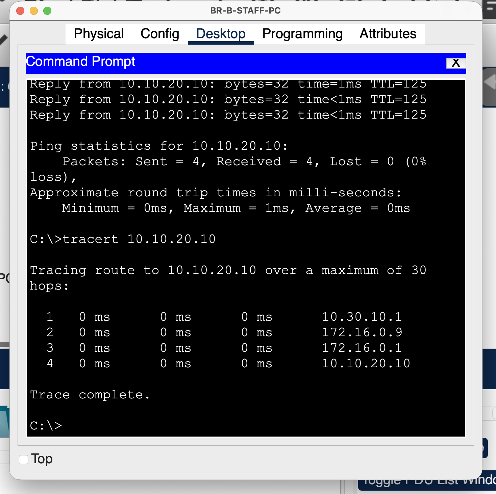

# Multi-Site Enterprise WAN | Cisco Packet Tracer

I designed and configured a three-site enterprise network connecting a headquarters office with two branch offices using Cisco Packet Tracer 9.0.

The network uses **multi-area OSPF** for dynamic routing, **VLANs** to separate staff and guest traffic, **DHCP** for automatic IP assignment, and **ACLs** to restrict guest access to internal networks.

I also configured an internal **DNS and HTTP server** at headquarters and tested WAN redundancy by shutting down a direct link. OSPF successfully rerouted traffic through the remaining branch, maintaining connectivity after convergence.

**Network devices:** 3 Cisco 2911 routers, 3 Cisco 2960 switches, 6 PCs, and 1 server.

## Project overview

I built a three-site enterprise network in Cisco Packet Tracer, connecting a headquarters office with two branch offices. I configured a triangular WAN topology with redundant links, allowing OSPF to reroute traffic when a direct WAN connection fails. Each location has separate Staff and Guest VLANs, while Headquarters also has a dedicated Servers VLAN.

### Implemented features

- **Redundant three-router WAN:** three point-to-point `/30` links connecting the sites.
- **Multi-area OSPF:** area 0 for WAN links, with separate LAN areas for each site. WAN interfaces form OSPF adjacencies; LAN interfaces are passive.
- **802.1Q router-on-a-stick:** VLAN gateways configured on router subinterfaces.
- **VLANs:** Staff (10), Servers (20 at HQ), and Guest (30), with access ports and allowed VLANs configured on switch trunks.
- **DHCP:** router-hosted Staff and Guest pools, with `.1`–`.20` addresses excluded. Staff pools provide the HQ DNS server address.
- **Centralized internal service:** HQ server `10.10.20.10` hosts DNS and HTTP. The DNS record `intranet.enterprise.test` points to that server.
- **Guest traffic filtering:** inbound extended ACLs on each Guest VLAN interface permit DHCP and local-gateway pings while blocking Guest-originated traffic to private internal address ranges.
- **Tested OSPF failover:** Simulated a WAN link failure between Branch B and Headquarters. After OSPF reconverged, traffic automatically rerouted through Branch A. Verified connectivity using ping and traceroute, with the path changing from 3 hops to 4 hops.

## Network topology and addressing

### WAN links

| Connection | Network | Endpoint addresses |
|---|---|---|
| HQ ↔ Branch A | `172.16.0.0/30` | HQ `G0/1: 172.16.0.1` · A `G0/1: 172.16.0.2` |
| HQ ↔ Branch B | `172.16.0.4/30` | HQ `G0/2: 172.16.0.5` · B `G0/1: 172.16.0.6` |
| Branch A ↔ Branch B | `172.16.0.8/30` | A `G0/2: 172.16.0.9` · B `G0/2: 172.16.0.10` |

### VLANs and default gateways

| Site | VLAN | Role | Subnet | Gateway | OSPF area |
|---|---:|---|---|---|---:|
| HQ | 10 | Staff | `10.10.10.0/24` | `10.10.10.1` | 10 |
| HQ | 20 | Servers | `10.10.20.0/24` | `10.10.20.1` | 10 |
| HQ | 30 | Guest | `10.10.30.0/24` | `10.10.30.1` | 10 |
| Branch A | 10 | Staff | `10.20.10.0/24` | `10.20.10.1` | 20 |
| Branch A | 30 | Guest | `10.20.30.0/24` | `10.20.30.1` | 20 |
| Branch B | 10 | Staff | `10.30.10.0/24` | `10.30.10.1` | 30 |
| Branch B | 30 | Guest | `10.30.30.0/24` | `10.30.30.1` | 30 |

**OSPF backbone:** all three WAN connections are in **area 0**. The router IDs are HQ `1.1.1.1`, Branch A `2.2.2.2`, and Branch B `3.3.3.3`.

**Switch port layout:** `Fa0/1` is the router trunk; `Fa0/2` is Staff VLAN 10; `Fa0/4` is Guest VLAN 30. At HQ, `Fa0/3` connects the server on VLAN 20. HQ trunks allow VLANs `10,20,30`; branch trunks allow `10,30`.

## Security design

An extended ACL is applied **inbound on each router's Guest VLAN subinterface**:

- HQ: `HQ-GUEST-IN-V2`
- Branch A: `BR-A-GUEST-IN`
- Branch B: `BR-B-GUEST-IN`

The ACLs allow DHCP requests and ICMP echo requests to each Guest subnet's local gateway, block Guest-originated traffic to `10.0.0.0/8`, `172.16.0.0/16`, and `192.168.0.0/16`, and permit traffic not matched by those deny rules.

**Scope:** These ACLs filter Guest-originated traffic entering the router. They do **not** constitute complete bidirectional segmentation, an edge firewall, or Internet access. This lab does not configure NAT or an ISP connection.

## Verification and test results

| Test | Verified observation |
|---|---|
| OSPF adjacency | Each router had two WAN neighbors in **FULL** state. |
| OSPF interface roles | Staff/Guest LAN interfaces were passive; WAN interfaces remained non-passive. |
| VLAN and trunks | Switch VLANs were active and correct VLANs were forwarding on 802.1Q trunks. |
| DHCP | Staff and Guest DHCP pools were configured on all three routers. The Branch B Guest pool was corrected to include the default gateway 10.30.30.1. |
| Internal DNS/HTTP | Staff PCs at HQ, Branch A, and Branch B accessed `http://intranet.enterprise.test`. |
| Guest filtering | Guest-to-internal-resource pings were blocked while pinging the local Guest gateway was permitted. |
| Normal HQ access from Branch B | Direct path, **OSPF cost 2**, successful ping, **3-hop traceroute** (including the local gateway). |
| HQ–Branch B link disabled | Shut down the direct WAN link and verified that OSPF rerouted traffic through Branch A after convergence. The alternate route had OSPF cost 3, with successful ping results and a 4-hop traceroute. |
| Link restored | Direct path returned, **OSPF cost 2**, successful ping. |

### WAN failover demonstration

The test disabled HQ router interface `GigabitEthernet0/2` (the direct link to Branch B). After OSPF reconverged, traffic from the Branch B Staff PC to the HQ server (`10.10.20.10`) followed the alternate path through Branch A. The direct link was then restored with `no shutdown`, and OSPF selected the shorter route again.



**Measurement limitation:** this was a reachability and route-selection test. Exact convergence duration and packet-loss percentage during the transition were **not measured**.

### Screenshots

| Evidence | File |
|---|---|
| Topology | [01-network-topology.png](Screenshots/01-network-topology.png) |
| Branch A VLANs | [02-branch-a-vlans.png](Screenshots/02-branch-a-vlans.png) |
| Branch A trunk | [03-branch-a-trunk.png](Screenshots/03-branch-a-trunk.png) |
| HQ VLANs | [04-hq-vlans.png](Screenshots/04-hq-vlans.png) |
| HQ trunk | [05-hq-trunk.png](Screenshots/05-hq-trunk.png) |
| OSPF neighbors | [06-ospf-neighbors.png](Screenshots/06-ospf-neighbors.png) |
| OSPF routes | [07-ospf-routing.png](Screenshots/07-ospf-routing.png) |
| HQ DHCP leases | [08-hq-dhcp-leases.png](Screenshots/08-hq-dhcp-leases.png) |
| DNS configuration | [09-dns-configuration.png](Screenshots/09-dns-configuration.png) |
| Branch B intranet access | [10-branch-b-intranet-access.png](Screenshots/10-branch-b-intranet-access.png) |
| Guest ACL | [11-guest-acl-security.png](Screenshots/11-guest-acl-security.png) |
| WAN failover | [12_ospf_wan_failover.png](Screenshots/12_ospf_wan_failover.png) |

## Repository structure

```text
Multi_Site_Enterprise_WAN_GitHub/
├── README.md
├── Multi_Site_Enterprise_WAN_Verified.pkt
├── configs/
│   ├── HQ_R1.txt
│   ├── BR_A_R1_FINAL.txt
│   ├── BR_B_R1_FINAL.txt
│   ├── HQ_SW1_CONFIG.txt
│   ├── BR_A_SW1_CONFIG.txt
│   └── BR_B_SW1_CONFIG.txt
└── Screenshots/
    ├── 01-network-topology.png
    ├── 02-branch-a-vlans.png
    ├── 03-branch-a-trunk.png
    ├── 04-hq-vlans.png
    ├── 05-hq-trunk.png
    ├── 06-ospf-neighbors.png
    ├── 07-ospf-routing.png
    ├── 08-hq-dhcp-leases.png
    ├── 09-dns-configuration.png
    ├── 10-branch-b-intranet-access.png
    ├── 11-guest-acl-security.png
    └── 12_ospf_wan_failover.png
```

## How to explore the lab

1. Install **Cisco Packet Tracer 9.0** or a compatible version.
2. Open `Multi_Site_Enterprise_WAN_Verified.pkt`.
3. On routers, inspect `show ip ospf neighbor`, `show ip route`, and `show ip protocols`.
4. On switches, inspect `show vlan brief` and `show interfaces trunk`.
5. On a Staff PC, open **Desktop → Web Browser** and visit `http://intranet.enterprise.test`.
6. To repeat the link-failure test, **save a separate copy of the `.pkt` file first**, then shut down HQ-R1 `GigabitEthernet0/2`. Restore it with `no shutdown` afterward.

**Note:** Cisco Packet Tracer switch VLAN database entries may be stored separately from `show running-config`; use `show vlan brief` to verify the VLAN definitions in the saved project.

## Current limitations and possible extensions

This is a learning and portfolio lab, **not a production-hardened network**. Potential additions include SSH/AAA management, default-route and NAT/ISP simulation, stronger guest isolation, centralized syslog/SNMP monitoring, and timed OSPF convergence tests.
